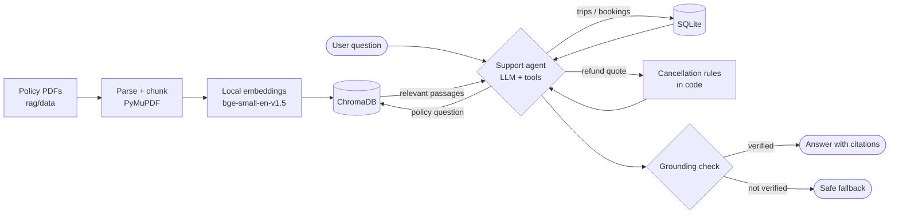

# 🧭 Wayfinder — AI Trip Planner Agent

Wayfinder turns a traveller's preferences into an **editable, map-based, day-by-day itinerary**. It only uses real, checkable data:

- **Places** come from OpenStreetMap, via Overpass.
- **Routes and travel times** come from OSRM.
- **The agent** is an LLM (Groq `gpt-oss-120b` or Google Gemini, set by `LLM_PROVIDER`), orchestrated with **LangChain**. It chooses and orders places but never invents them.
- **The support assistant** (Help & bookings page) answers from the agency's policy PDFs via RAG (local ChromaDB + local embeddings) and from your own trips and bookings, and can cancel a booking after you confirm.

When a route can't be found, the app says so. It never makes up a travel time.

```text
┌───────────────────────┐   HTTP/JSON   ┌──────────────────────────────────────────┐
│  Streamlit UI          │ ────────────▶ │  FastAPI backend                          │
│  • planner form        │ ◀──────────── │  • routers (geocode, trips)               │
│  • PyDeck map          │  NDJSON        │  • PlanService (pipeline)                 │
│  • itinerary + chat    │  progress      │  • TripAgent  ← LangChain tool-calling    │
└───────────────────────┘               │      tools: find_places · check_route ·   │
                                          │             ask_user · submit_itinerary   │
                                          │  • clients: Nominatim · Overpass · OSRM   │
                                          │  • validator · scheduling · SQLite        │
                                          └──────────────────────────────────────────┘
```

## Tech stack

| Layer | Technology |
|---|---|
| Language | Python |
| Frontend | Streamlit |
| Map rendering | pydeck |
| Backend API | FastAPI + Uvicorn |
| Agent orchestration | LangChain |
| LLM | Groq (`openai/gpt-oss-120b`) or Google Gemini, chosen by `LLM_PROVIDER` |
| RAG | ChromaDB + `BAAI/bge-small-en-v1.5` (sentence-transformers, local) + PyMuPDF |
| Geocoding | Nominatim (OpenStreetMap) |
| Places | Overpass API (OpenStreetMap) |
| Routing | OSRM (FOSSGIS server) |
| Storage | SQLite |
| Testing | pytest + Streamlit AppTest |

## Quick start

```bash
python -m venv venv
venv\Scripts\activate           # macOS/Linux: source venv/bin/activate
pip install -r requirements.txt
copy .env.example .env          # macOS/Linux: cp .env.example .env
# edit .env: set LLM_PROVIDER + GROQ_API_KEY (or GEMINI_API_KEY) and put your email in HTTP_USER_AGENT
python -m backend.support.ingest   # optional: index rag/data/*.pdf now (else done on startup)
python run.py
```

- App: http://localhost:8501
- API docs: http://localhost:8000/docs

Use a virtual environment. This project needs `langchain-core>=0.3`, which could conflict with an older global LangChain install.

Run the tests with `pytest backend/tests -q`. They use no network and no real database.

## How the agent works (LangChain)

`backend/services/agent.py` is a small, explicit tool-calling loop. It uses `ChatGoogleGenerativeAI.bind_tools(...)`, `AIMessage.tool_calls` and `ToolMessage`:

| Tool | What it does |
|---|---|
| `find_places(interests, must_see)` | Searches OpenStreetMap near the destination and returns candidate places with IDs |
| `check_route(stops)` | Routes one day with OSRM and returns real travel times, the schedule, and whether the day fits the time window |
| `ask_user(question, quick_replies)` | Asks the traveller a follow-up question, then stops and waits |
| `submit_itinerary(days, summary, assumptions)` | The final answer. The backend validates it (known IDs, no duplicates, right day count, sensible durations). If it is invalid, the errors go back to the agent to fix |

Every answer passes through the backend's checks before it is shown:
- The backend routes each day, schedules it and validates it: overflow of the daily window, pace, long legs, missing routes, duplicates and unknown opening hours.
- Problems are shown as warnings in the UI.
- The chat box reuses the same agent, adding the current plan and the conversation so far.

## API call flow

### Planning a trip

```text
1. User types a city and presses Search
   Streamlit ──POST /api/geocode/search──▶ FastAPI ──GET /search──▶ Nominatim
   ◀── up to 5 matches (name, lat/lon, bounding box) ──

2. User searches a start point
   Streamlit ──POST /api/geocode/search {near_bbox}──▶ FastAPI ──GET /search (bounded to city)──▶ Nominatim
                                                              (falls back to a worldwide search if nothing is found)

3. User presses "Plan my trip"
   Streamlit ──POST /api/trips/generate──▶ FastAPI   (response is streamed as NDJSON)
      PlanService.generate()
        └─ TripAgent.run()  ── loop, max 10 steps ──
             ├─ LangChain ──▶ Gemini: system prompt + trip request + tools
             ├─ Gemini calls find_places(interests, must_see)
             │     ├─ FastAPI ──POST──▶ Overpass (mirror on 504)   → candidate places
             │     └─ FastAPI ──GET──▶ Nominatim (inside the area) → must-see places
             │     ◀─ ToolMessage: candidates ─▶ Gemini            [stream: "Searching OpenStreetMap…"]
             ├─ Gemini calls check_route(stops)  (once per day)
             │     └─ FastAPI ──GET /routed-foot|car/route/v1/…──▶ OSRM
             │     ◀─ ToolMessage: leg times + schedule ─▶ Gemini  [stream: "Checking real travel times…"]
             ├─ Gemini calls ask_user(question) → stream "question" → the UI shows chips and the answer
             │     is sent back as a new generate request with clarifications
             └─ Gemini calls submit_itinerary(plan)
                   └─ backend checks it (known IDs, no duplicates, day count, 10–240 min)
                        invalid → errors go back to Gemini as a ToolMessage → it resubmits
        ├─ route each day (reuses cached legs) ──▶ OSRM
        ├─ schedule + validate each day
        └─ save to SQLite (status "generated")
   ◀── stream: stage events … then {"type": "result", "trip": …}

   If there's no API key or Gemini fails: Overpass + Nominatim → built-in planner → OSRM → SQLite
```

### Editing a trip

```text
Move / replace / remove / add / note / visit time
   Streamlit ──PATCH|DELETE|POST /api/trips/{id}/days/{day}/stops…──▶ FastAPI
      load from SQLite → change the stops → route only new legs ──▶ OSRM → reschedule → validate → save
   ◀── {trip, rerouted_legs}

Recalculate route
   ──POST …/days/{day}/recalculate──▶ re-route every leg (ignores the cache) ──▶ OSRM
```

### Chat refinement

```text
Streamlit ──POST /api/trips/{id}/chat──▶ FastAPI (streamed)
   TripAgent.run() with: current plan + known candidates + last 10 messages
     ├─ may call find_places (e.g. "add a beach") ──▶ Overpass / Nominatim
     ├─ may call check_route ──▶ OSRM
     └─ submit_itinerary → re-route and validate  |  ask_user → question  |  plain text → reply
   save the plan and chat history to SQLite
◀── {"type": "result", "trip": …, "changed": true|false}
```

### Other endpoints

| Call | Purpose |
|---|---|
| `GET /api/health` | Backend status, agent on or off, model name (sidebar) |
| `GET /api/trips` | List saved trips (sidebar) |
| `GET /api/trips/{id}` | Open a trip |
| `POST /api/trips/{id}/save` | Mark a draft as saved, with a title |
| `DELETE /api/trips/{id}` | Delete a trip and all its days, stops and routes |

## Support assistant & bookings (RAG)

Wayfinder is presented as the app of **Wayfinder Holidays Pvt. Ltd.**, a fictional tour operator selling domestic
(India) and international trips. A planned trip can be booked with **Book this trip** (fare type Standard, Flexi or
Promo; no prices in this version). The **Help & bookings** page has a separate support assistant and a **Dev board**.



**Knowledge sources** (the assistant may use nothing else):

| Source | What | How |
|---|---|---|
| Policy PDFs | `rag/data/WH-POL-*.pdf` | PyMuPDF → chunks → local embeddings → ChromaDB in `rag/chroma` (rebuilt when the PDFs change) |
| Trips & bookings | SQLite | read-only tools `list_trips`, `get_trip`, `list_bookings`, `get_booking` |
| Cancellation rules | `backend/support/policy_rules.py` | `quote_cancellation`: tier, charge %, refund %, non-refundables, refund date are **computed in code**, never by the LLM |
| System facts | limits from `backend/domain/models.py` and config | in the system prompt; they override documents |

**Not hallucinating (checked in code, `backend/support/agent.py`):**
- Policy search results below `RAG_SCORE_THRESHOLD` come back as `NO_RELEVANT_POLICY`, and the assistant must say it doesn't know.
- Every citation `[WH-POL-003 p.2]` must come from a search in that turn; every percentage, ISO date and booking/cancellation reference must appear in a tool result. A failing answer is sent back once to be fixed, then replaced by a safe "I couldn't verify that" message.
- Document text, trip notes and DB values are treated as data, not instructions.

**Cancelling:** the assistant quotes the policy-based charge (days before departure in IST, 18:00 cutoff), explains it with citations, and shows a **Confirm cancellation** card. Only the button calls `POST /api/support/confirm/{quote_id}`, which re-checks the quote (15-minute expiry), sets the booking to `cancelled`, issues a `CXL-…` reference and marks the refund `initiated`, in one transaction. Confirming twice changes nothing. Visa refusal, force majeure and exceptions are referred to Customer Care. A booked trip can't be deleted until it's cancelled.

**Dev board:** for each turn, total latency, LLM calls with latency and input/output tokens (shown as "n/a" when the provider reports none), every policy search with embedding and vector-search time, chunk scores, document, version and page, tool arguments and results, grounding-check results and DB writes. The **Knowledge base** view shows the indexed PDFs and chunk count and can rebuild the index.

**No LLM key:** the support page still works and shows the best-matching policy sections instead of an AI answer.

| Call | Purpose |
|---|---|
| `POST /api/trips/{id}/book` | Book a trip (`{"fare_type": "standard"\|"flexi"\|"promo"}`) |
| `GET /api/bookings` | All bookings |
| `POST /api/support/chat` | Ask the assistant (NDJSON stream of `trace` events, then `result`) |
| `POST /api/support/confirm/{quote_id}` · `POST /api/support/keep/{quote_id}` | Confirm or decline a cancellation |
| `GET`/`DELETE /api/support/history` | Support conversation |
| `GET /api/support/traces` | Dev board data |
| `GET /api/support/index` · `POST /api/support/reindex` | Index stats / rebuild |

## Using the app

1. **Destination.** Type a city and press **Search**, then pick the right match. Nothing is chosen automatically.
2. **Start point.** Search for your hotel or station (results near the destination come first), enter coordinates, or use the city centre.
3. **Trip details.** Set dates (1–7 days), the daily time window, interests, pace, walking or driving, must-see places and notes.
4. **Plan my trip.** Watch the agent's live progress. It may ask a quick question.
5. **Review on the map.** Stops are numbered and coloured by day. Routed legs are solid lines, and legs with no route are dashed. Click a marker to highlight its card.
6. **Edit.** Move stops up or down, remove, replace with a nearby real place, add notes, change visit times, add places, or ask the assistant. Only the legs affected by an edit are re-routed.
7. **Save and export.** Save the trip, export it to a calendar file (.ics) or JSON, or open a day in Google Maps.

## Configuration (`.env`)

See `.env.example`. The main settings are:
- `LLM_PROVIDER` (`groq` or `gemini`), with `GROQ_API_KEY` / `GROQ_MODEL` (default `openai/gpt-oss-120b`) or `GEMINI_API_KEY` / `GEMINI_MODEL`, and `LLM_TIMEOUT_S`.
- Support assistant: `HOME_COUNTRY` (domestic vs international), `RAG_DATA_DIR`, `CHROMA_DIR`, `EMBEDDING_MODEL`, `RAG_SCORE_THRESHOLD`, `RAG_TOP_K`.
- `HTTP_USER_AGENT`: public OSM services need an identifying User-Agent with contact info.
- Provider URLs and timeouts.
- `SQLITE_PATH`.
- `BACKEND_BASE_URL`, used by the UI.

## Choices that differ from `implementation.md`

- **Routing host:** the default is `routing.openstreetmap.de` (FOSSGIS OSRM). The public `router.project-osrm.org` only has a car profile, so "walking" times from it would really be driving times. Any OSRM host can be set in `.env`.
- **Timeouts:** Overpass defaults to 25 s and Gemini to 45 s, because real city queries often take longer than 12 s and 25 s. Both are configurable.
- **One Overpass query:** a single union query covers all interests, instead of one per category. It is gentler on the public server's limits. The public server often answers 504 when it is busy, so a mirror (`OVERPASS_FALLBACK_URL`) is tried automatically.
- **Must-see places:** looked up with Nominatim inside the destination area, which is fast and tolerant of spelling. A name regex in Overpass took over 60 s.
- **Start-point search:** looks inside the destination area first and falls back to a worldwide search, so "Hotel Avenida Palace" finds the Lisbon hotel rather than one in Brazil.
- **Extra SQLite fields:**
  - `trips.candidates_json`: the sourced places, used for replace/add and chat.
  - `trips.chat_json`: the chat history.
  - `itinerary_days.summary` and `itinerary_days.issues_json`.
  - `stops.reason`: why the agent chose the stop.
- **Drafts:** generated trips are stored as drafts (`generated`), so they can be edited before saving. Unsaved drafts older than 7 days are cleaned up on startup.
- **Streaming progress:** `generate` and `chat` stream NDJSON progress events.

## Limits

This is a single-user local MVP.
- It does not verify opening hours, prices or bookings, and never claims to.
- Public OSM services have fair-use limits and can be slow or busy. The app shows clear retry messages when that happens.
